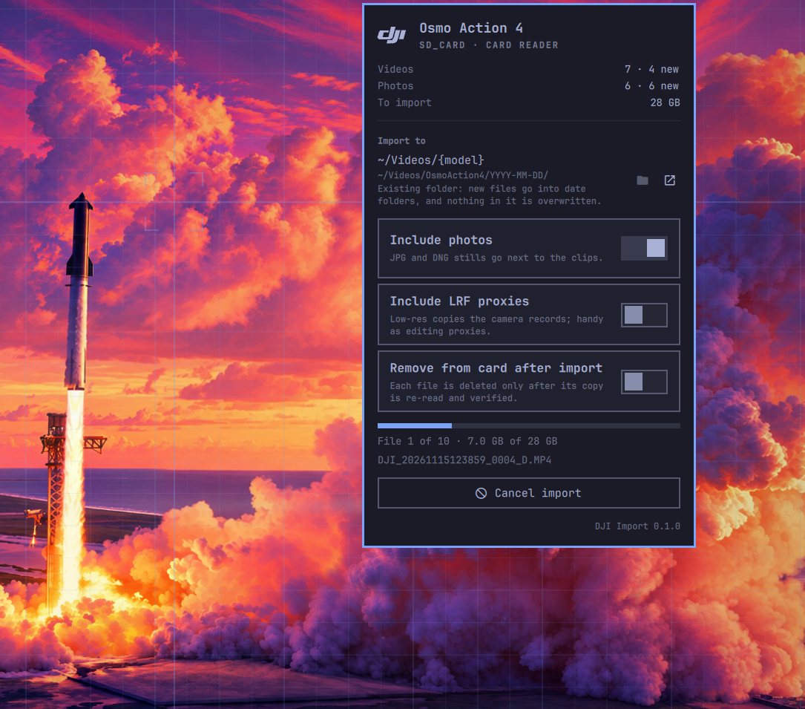

# omarchy-dji

Import footage from DJI Osmo cameras (Action 4/5, Pocket 3, Osmo 360, …) on
[Omarchy](https://omarchy.org). A bar icon appears when a camera or its card
is connected. The panel shows what's new on the card and copies it into
dated folders:

```
~/Videos/OsmoAction4/
├── 2026-11-14/
│   ├── DJI_20261114093012_0001_D.MP4
│   └── DJI_20261114093544_0002_D.JPG
└── 2026-11-15/
    └── DJI_20261115115741_0001_D.MP4
```



It isn't affiliated with or endorsed by DJI. Plugins run unsandboxed inside
`omarchy-shell`.

> [!WARNING]
> **This is early, in-development software. Use it at your own risk.** It's
> only been tested with an Osmo Action 4; other DJI models should work but
> haven't been tried. It's built to be careful: it never overwrites anything,
> and "Remove from card after import" is off by default. Even with that
> setting on, a card file is only deleted after its copy has been read back
> from disk and verified. Still, bugs happen. **Keep a backup of anything you
> can't afford to lose, and don't blame us if it eats your footage or wipes
> your card.** The software is provided "as is", without warranty of any
> kind (see [LICENSE](LICENSE)). If something goes wrong, please
> [open an issue](https://github.com/astorrer/omarchy-dji/issues).

## Install

```sh
omarchy plugin add https://github.com/astorrer/omarchy-dji.git --enable
```

You need `python3`, which comes with Omarchy (it uses only the standard
library). Nothing runs as root, and the plugin makes no network calls.

## Usage

1. Plug in the camera and pick **Transfer** mode on its screen, or put the
   card in a card reader. Omarchy mounts it, the DJI icon shows up on the bar,
   and you get a notification saying how many files are new. Hover the icon
   for the count. The icon takes the bar's active color while an import runs.
2. Click the icon, check the destination, and press **Import**. You can
   cancel at any point. A cancelled copy never leaves a half-written file.
3. Once everything is imported, **Clean up card** frees the card. It deletes
   only files that are already in your library, and only after hashing both
   copies and checking they match. Files that aren't imported yet are never
   touched. Each removed clip's `.LRF` proxy, a low-res copy the camera
   makes, goes with it. A confirmation comes first, with Cancel preselected.

| Setting | Default | |
|---|---|---|
| Import path | `~/Videos/{model}` | `{model}` is the name the camera reports, e.g. `OsmoAction4`, `OsmoPocket3`. Pick a folder with the 󰉋 button: `/{model}` is added so each camera keeps its own folder (picking `~/Footage` gives `~/Footage/OsmoAction4/…`). For any other layout, including no camera folder, type the path in the widget settings. |
| Include photos | on | JPG/DNG stills go next to the clips. |
| Include LRF proxies | off | The camera's low-res proxy copies. |
| Remove from card after import | off | Deletes each card file only after its copy has been fsynced, re-read from disk, and its hash compared with the original. |
| Notify on connect | on | |
| Always show icon | off | By default the icon only shows while a DJI camera or card is present. |

The 󰑐 button in the panel header rescans the card, and so does a right-click
on the bar icon. A middle-click on the icon opens the import folder. With the
panel open, <kbd>Enter</kbd> imports, <kbd>o</kbd> opens the folder, and
<kbd>r</kbd> rescans.

## Existing folders

It's safe to point the import path at a folder you already use:

- Nothing in the destination is ever overwritten, moved, or deleted. New files
  only go into `YYYY-MM-DD/` subfolders.
- If a different file already has a clip's name in its date folder (say, from
  a second camera of the same model), the clip is imported as
  `DJI_…_0003_D-2.MP4` instead. Both files are kept, nothing is left behind on
  the card, and later imports recognize the renamed copy.
- Only missing folders are created. Existing folders and their permissions
  aren't touched.
- The import won't start if the path is on the card itself, goes through a
  file instead of a folder, or isn't writable.
- A symlinked destination, for example a NAS mount, works fine.

## How it works

`dji.py` does all the work, and you can also run it as a CLI on its own. In a
terminal, `import` shows a live progress bar with speed and time left:

```sh
./dji.py status                 # camera, card, and what's new
./dji.py import --dry-run       # what would be copied where
./dji.py import                 # copy new media
./dji.py import --move          # copy, verify, then remove from the card
./dji.py clean                  # remove already-imported files (asks first)
./dji.py clean --dry-run        # what clean would remove
./dji.py import --dest '/mnt/nas/{model}' --no-photos --proxies
```

Detection:

- **Card:** any mounted FAT/exFAT/NTFS volume that has a `DCIM/DJI_*` folder.
- **Camera model:** read from the USB device (vendor `2ca3`) when the camera
  itself is connected. With a card reader, it's taken from the clip's MP4
  metadata or the photo's EXIF.
- **Folder name:** the name the camera reports, e.g. `OsmoAction4`.
- **Already imported:** a file counts as imported when one with the same name
  and size is anywhere inside the import folder. If you've reorganized the
  library, say into trip folders, nothing gets copied twice.
- **Wrong USB mode:** if the camera is plugged in but no card is mounted
  (webcam mode), the panel tells you to switch it to Transfer mode.

Each date folder comes from the timestamp in the DJI filename, which is the
camera's local time. Copies keep the original modification time.

## Development

```sh
ln -s "$PWD" ~/.config/omarchy/plugins/io.github.astorrer.omarchy-dji
omarchy-shell shell rescanPlugins
omarchy plugin enable io.github.astorrer.omarchy-dji
./tests/run     # ruff, unit tests, manifest checks, plugin validate, qmllint
```

The shell doesn't hot-reload a symlinked plugin. Run `omarchy restart shell`
to load QML changes.

## License

MIT. DJI, Osmo, and the DJI logo are trademarks of SZ DJI Technology Co.,
Ltd. The logo is used only to identify compatible cameras.
